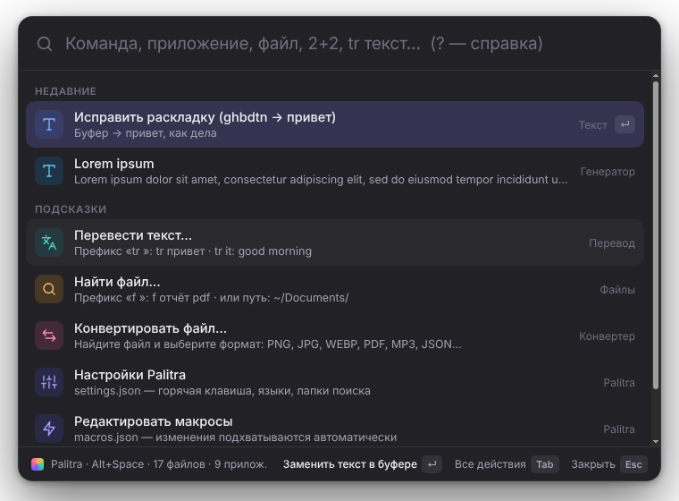
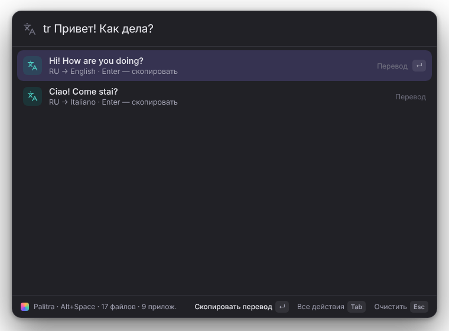
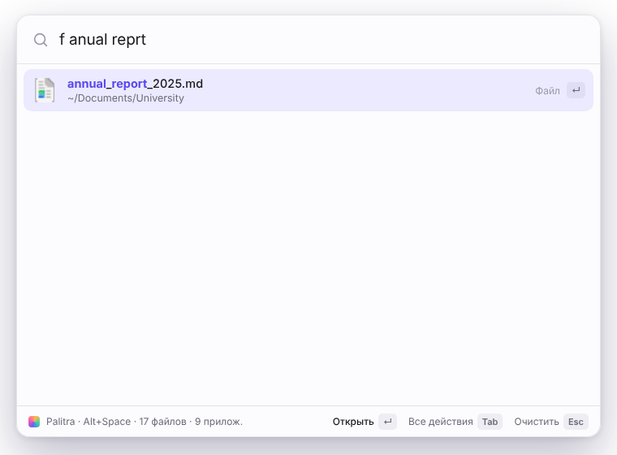
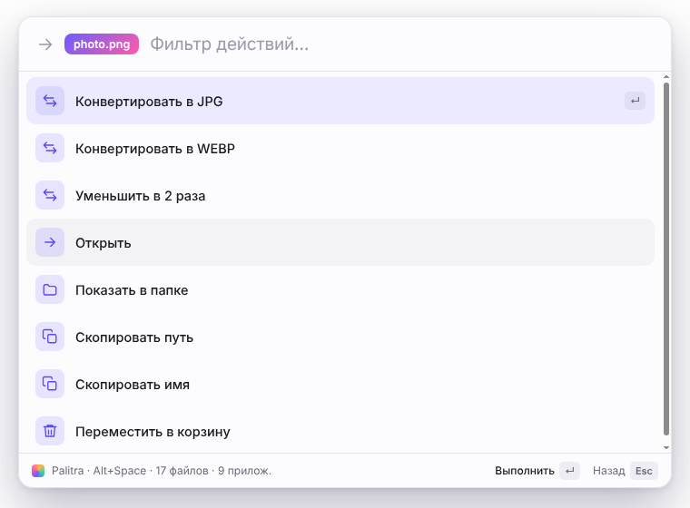
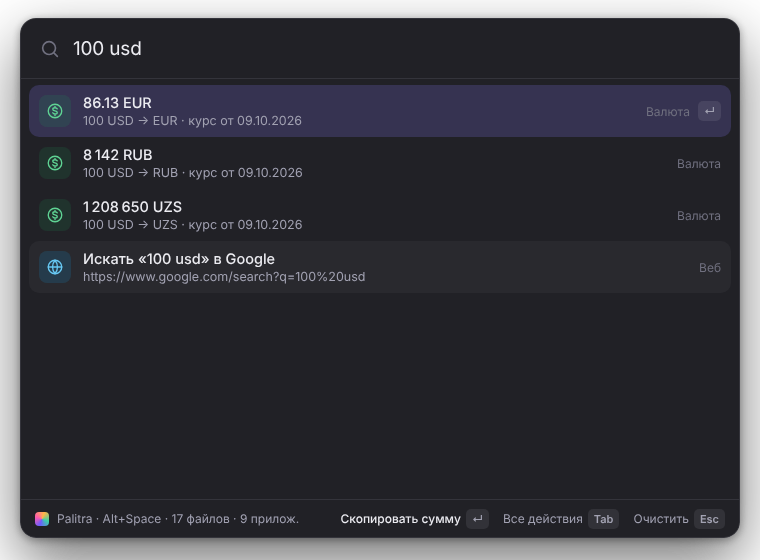

<div align="center">


# Palitra

**Глобальная командная палитра для Windows, macOS и Linux.**
Нажмите <kbd>Alt</kbd>+<kbd>Space</kbd> — и запускайте приложения и макросы, ищите файлы, конвертируйте форматы и переводите текст, не трогая мышь.

</div>

<p align="center">
  
  
</p>

## Что умеет

| | |
|---|---|
| 🔎 **Умный поиск** | Прощает опечатки (`tarnslate` → *Translate*), понимает неправильную раскладку (`ghtdtcnb` → *Перевести*), аббревиатуры (`vsc` → *Visual Studio Code*) и подсвечивает совпадения. |
| 🧠 **Учится на вас** | Ранжирует команды по частоте **и** давности использования (frecency) и запоминает, что вы выбираете для конкретного запроса: набрали `tr` и выбрали «Перевод» — в следующий раз он будет первым. |
| ⚡ **Макросы** | Цепочки шагов в `macros.json`: открыть сайты/папки/программы, выполнить команду в терминале, вставить текст, нажать сочетание клавиш, вызвать любую команду Palitra. Свои горячие клавиши для каждого макроса. |
| 🔄 **Конвертация форматов** | PNG ⇄ JPG ⇄ WEBP (+ SVG, AVIF, ICO, GIF, BMP на входе), CSV → JSON, JSON → CSV/YAML, YAML → JSON, Markdown → HTML. С LibreOffice: DOCX/XLSX/PPTX → PDF и др. С FFmpeg: видео → MP4/GIF/MP3, аудио → MP3/WAV/OGG/M4A. HEIC → JPG на macOS. |
| 🌍 **Перевод** | `tr привет` — сразу в несколько языков; `tr it: good morning` — в конкретный. |
| 📁 **Поиск файлов** | Фоновый индекс домашней папки, нечёткий поиск с опечатками, навигация по папкам с клавиатуры (`~/Doc…`), действия: открыть, показать в папке, скопировать путь, конвертировать, в корзину. |
| 🧮 **Мгновенные ответы** | Калькулятор (`sqrt(2)*10 + 15%`), единицы (`10 km to mi`, `5 гб в мб`), валюты (`100 usd`, `5000 сум в рублях`), цвета (`#6c5cff`), системы счисления (`0xff`), Unix-время. |
| ✂️ **Текст в буфере** | 35 преобразований скопированного текста: исправить раскладку, регистр, camelCase/snake_case, Base64, URL, JSON/YAML, хэши, сортировка строк, подсчёт слов… с предпросмотром результата. |
| 🖥 **Система** | Блокировка, сон, перезагрузка (с подтверждением), очистка корзины, снимок экрана, терминал, диспетчер задач, быстрые папки. |
| 🌐 **Веб** | `g запрос`, `yt`, `gh`, `w`, `so`, `maps`, `ai` — и свои поисковики в настройках. Набранный адрес сайта открывается сразу. |

<p align="center">
  
  
  
</p>

## Установка

### Готовая сборка
Установщики для Windows (`.exe`), macOS (`.dmg`) и Linux (`.AppImage`, `.deb`) собираются GitHub Actions — смотрите раздел [Releases](../../releases). Чтобы собрать новый релиз, создайте тег: `git tag v0.1.0 && git push --tags` (или запустите workflow **Build installers** вручную во вкладке *Actions*).

> **macOS:** приложение не подписано — при первом запуске нажмите на нём правой кнопкой → «Открыть». Для вставки текста в другие программы разрешите Palitra доступ в *Настройки → Конфиденциальность → Универсальный доступ*.
>
> **Linux:** для вставки текста и шагов `keys` в макросах установите `xdotool` (X11) или `wtype` (Wayland).

### Из исходников
Нужен [Node.js](https://nodejs.org) 20+.

```bash
git clone https://github.com/abdulvoris2984/palitra.git
cd palitra
npm install
npm start            # запуск
npm run dist:win     # собрать установщик (или dist:mac / dist:linux)
```

## Как пользоваться

Palitra живёт в трее. Сочетание по умолчанию — <kbd>Alt</kbd>+<kbd>Space</kbd> (если занято, будет выбрано <kbd>Ctrl</kbd>+<kbd>Shift</kbd>+<kbd>Space</kbd>). Сменить: команда «Изменить горячую клавишу…» — просто нажмите новое сочетание.

### Префиксы

| Запрос | Что делает |
|---|---|
| *просто текст* | Команды, приложения, макросы, файлы и мгновенные ответы вместе |
| `tr <текст>` / `пер <текст>` | Перевод в языки из настроек · `tr it: …` или `tr>de,fr …` — в указанные |
| `f <имя>` | Только файлы |
| `conv <имя>` | Файлы, которые можно конвертировать; <kbd>Enter</kbd> показывает форматы |
| `~/`, `/`, `C:\` | Навигация по папкам; <kbd>Enter</kbd> на папке — войти внутрь |
| `> <команда>` | Только команды и макросы |
| `g`, `yt`, `gh`, `w`, `so`, `maps`, `ai` + запрос | Поиск в интернете |
| `?` | Справка прямо в палитре |

### Клавиши

| Клавиши | Действие |
|---|---|
| <kbd>↑</kbd> <kbd>↓</kbd> · <kbd>Ctrl</kbd>+<kbd>N</kbd>/<kbd>P</kbd> | Выбор |
| <kbd>Enter</kbd> | Основное действие |
| <kbd>Ctrl</kbd>+<kbd>Enter</kbd> | Второе действие (например, «вставить» вместо «скопировать») |
| <kbd>Tab</kbd> · <kbd>Ctrl</kbd>+<kbd>K</kbd> · <kbd>Shift</kbd>+<kbd>Enter</kbd> | Все действия элемента |
| <kbd>Alt</kbd>+<kbd>1</kbd>…<kbd>9</kbd> (<kbd>⌘</kbd>+<kbd>1</kbd>…<kbd>9</kbd>) | Выполнить N-й результат |
| <kbd>Esc</kbd> | Назад → очистить → закрыть |

Опасные команды (выключение, перезагрузка, очистка корзины) требуют повторного <kbd>Enter</kbd>.

## Настройки

Файлы лежат в папке данных приложения (команда «Открыть папку конфигурации»): `%APPDATA%\Palitra` на Windows, `~/Library/Application Support/Palitra` на macOS, `~/.config/Palitra` на Linux. Изменения подхватываются сразу после сохранения.

`settings.json`:

| Ключ | По умолчанию | Описание |
|---|---|---|
| `hotkey` | `"Alt+Space"` | Сочетание вызова ([формат Electron](https://www.electronjs.org/docs/latest/api/accelerator)) |
| `commandHotkeys` | — | Глобальные сочетания для любых команд: `{ "text:fixLayout": "Ctrl+Alt+L" }` |
| `launchAtLogin` | `true` | Автозапуск |
| `theme` | `"system"` | `system`, `light` или `dark` |
| `hideOnBlur` | `true` | Скрывать палитру при потере фокуса |
| `translate.targets` | `["ru","en","it"]` | Языки для `tr` (язык оригинала пропускается) |
| `currency.targets` | `["EUR","USD","RUB","UZS"]` | Валюты для `100 usd` без указания цели |
| `files.roots` | `[]` (домашняя папка) | Папки для индекса, например `["~", "D:\\Projects"]` |
| `files.exclude` | `node_modules`, `AppData`, … | Имена папок, которые не индексируются |
| `files.maxDepth` / `maxEntries` | `7` / `150000` | Ограничения индекса |
| `showFilesInMainSearch` | `true` | Показывать файлы без префикса `f` |
| `webSearch` | Google, YouTube, … | Свои поисковики: `"npm": { "name": "npm", "url": "https://www.npmjs.com/search?q=%s" }` |

Идентификатор любой команды для `commandHotkeys` и макросов — это её `id`: `text:upper`, `text:fixLayout`, `cmd:translate`, `cmd:lock`…  (полный список — в `src/main/providers/builtins.js` и `src/core/transforms.js`).

## Макросы

`macros.json` — список макросов, каждый из шагов:

```json
{
  "macros": [
    {
      "name": "Учёба",
      "keywords": ["study", "university"],
      "hotkey": "Ctrl+Alt+S",
      "steps": [
        { "type": "open", "target": "https://classroom.google.com" },
        { "type": "open", "target": "~/Documents/University" },
        { "type": "open", "target": "Visual Studio Code" },
        { "type": "notify", "text": "Удачи на парах!" }
      ]
    },
    {
      "name": "Найти в Google Scholar",
      "input": "Тема статьи",
      "steps": [{ "type": "open", "target": "https://scholar.google.com/scholar?q={input:url}" }]
    }
  ]
}
```

| Шаг | Поля | Что делает |
|---|---|---|
| `open` | `target` | Открывает URL, файл/папку или приложение по имени |
| `shell` | `command`, `wait`, `copyOutput` | Выполняет команду; вывод доступен как `{last}` |
| `copy` | `text` | Кладёт текст в буфер |
| `paste` | `text` *(необяз.)* | Вставляет текст (или буфер) в активное окно |
| `keys` | `combo` | Нажимает сочетание: `"ctrl+shift+t"`, `"mod+s"` (`mod` = ⌘ на Mac, Ctrl иначе), `"enter"` |
| `delay` | `ms` | Пауза |
| `notify` | `text`, `title` | Системное уведомление |
| `command` | `id`, `arg` | Любая команда Palitra, например `text:upper` |

Переменные в строках: `{input}`, `{clipboard}`, `{last}`, `{date}`, `{time}`, `{datetime}`, `{home}`, `{desktop}`, `{documents}`, `{downloads}`; с суффиксом `:url` — в URL-кодировке (`{input:url}`). Поле `input` заставляет палитру спросить значение перед запуском.

## Как устроен поиск

Каждый запрос сравнивается с названием и ключевыми словами (на русском и английском) в несколько ступеней — от строгой к мягкой, побеждает лучшая:

1. **точное совпадение / префикс** всей строки — 0.95–1.0;
2. **аббревиатура и цепочка префиксов слов** — `vsc`, `vscode` → *V*isual *S*tudio *C*ode — ~0.85;
3. **подстрока** — 0.74–0.84;
4. **каждое слово запроса** находит слово цели: префикс, подстрока или префикс **с опечатками** (расстояние Дамерау–Левенштейна с перестановками; 1 ошибка для слов из 4–6 букв, 2 — для 7–9; ошибка в первой букве «стоит» дороже);
5. **разрежённая подпоследовательность** (как в fzf) — бонусы за подряд идущие символы и начала слов.

Тот же запрос пробуется в другой раскладке (`ghbdtn` ⇄ `привет`) с небольшим штрафом. Итоговый балл:

```
score = совпадение × 100  +  frecency (0…22)  +  выбор для этого запроса (0…18)  +  поправка источника
frecency = Σ 0.5^(возраст / 5 дней) по последним 25 использованиям + 0.3·ln(1 + всего использований)
```

Поэтому команда, которой вы пользовались сегодня, обгоняет чуть лучшее по тексту, но не используемое совпадение — но никогда не обгоняет точное. Индекс файлов (до 150 тыс.) обходится в два прохода: сначала дешёвый фильтр по символам и строгое совпадение, а медленный поиск с опечатками — только если найдено мало.

## Архитектура

```
src/
├── core/                 чистая логика без Electron, покрыта тестами
│   ├── fuzzy.js          нечёткий поиск, опечатки, раскладка, подсветка
│   ├── frecency.js       частота + давность, запоминание запросов
│   ├── ranker.js         итоговый рейтинг
│   ├── calculator.js     безопасный парсер выражений (без eval)
│   ├── units.js currency.js numbers.js   мгновенные ответы
│   ├── transforms.js formats.js text.js  преобразования текста и форматов
│   └── keys.js           сочетания клавиш для SendKeys / AppleScript / xdotool
├── main/                 главный процесс Electron
│   ├── main.js           окно, глобальные клавиши, трей, автозапуск, IPC
│   ├── search.js         маршрутизация запросов, слияние и потоковая выдача
│   ├── convert.js        конвертация файлов (Chromium, LibreOffice, FFmpeg, sips)
│   ├── providers/        builtins, apps, files, macros, translate, currency, web, quick
│   └── settings.js clipboard.js system.js store.js actions.js
├── renderer/             интерфейс палитры (без фреймворков)
└── preload.js            узкий мост contextBridge
```

Окно — прозрачное, без рамки, с `contextIsolation` и `sandbox`; интерфейс общается с главным процессом только через `preload.js`. Изображения конвертируются в рендерере средствами Chromium, поэтому WebP/AVIF/SVG работают без нативных зависимостей.

## Приватность

Палитра работает локально. В сеть уходят только: текст после префикса `tr` (Google Translate, при ошибке — MyMemory) и запрос курсов валют, когда вы набираете сумму с валютой (open.er-api.com, запасной — currency-api на jsDelivr; кэш на 6 часов). Индекс файлов хранится только в памяти, история использования — в `usage.json` у вас на диске (команда «Очистить историю использования» её сбрасывает).

## Разработка

```bash
npm test          # 50+ модульных и интеграционных тестов (node:test)
npm run lint      # проверка синтаксиса всех файлов
npm run dev       # запуск с DevTools и без скрытия при потере фокуса
```

Идеи на будущее: история буфера обмена, сниппеты с плейсхолдерами, плагины на JS, OCR текста с экрана, синхронизация настроек.

## Лицензия

[MIT](LICENSE)
